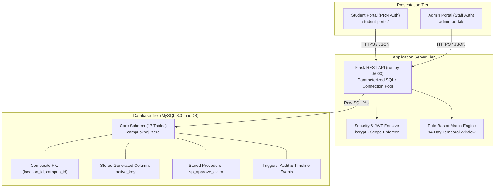

# CampusKhoj: A Two-Campus Lost & Found Relational Database Management System

**Course**: Database Management Systems (DBMS) Laboratory Project  
**Academic Year**: 2026–2027  
**Database**: MySQL Community Server 8.0.46 (InnoDB Engine)  
**Backend**: Python 3.11.9 (Flask REST API, Parameterized SQL, No ORM)  
**Frontend**: Vanilla HTML5, ES6 Modules, Tailwind CSS, Self-Hosted Fonts  

---

## 1. Abstract

Campus life across distributed collegiate campuses frequently suffers from property loss, fragmented communication, and security vulnerabilities. Conventional informal approaches—such as broadcast messaging on WhatsApp groups or unindexed paper security registers—fail due to lack of categorization, rapid message burial, zero search capability, and vulnerability to fraudulent claims.

**CampusKhoj** is an enterprise-grade, two-campus (Kondhwa and Bibwewadi) lost-and-found management system engineered with a database-first philosophy. Built on MySQL 8.0, CampusKhoj embeds institutional business policies directly into the relational engine using **composite foreign keys** `(location_id, campus_id)` to prevent cross-campus location anomalies, a **stored generated column** `active_key` to guarantee a single active claim invariant, and an atomic **stored procedure** `sp_approve_claim` to ensure ACID compliance during competing claim resolutions. The presentation layer features two discrete portals (Student Portal and Admin Portal) driven by a unified Python REST API using raw parameterized SQL. Comprehensive verification includes 35 automated test suites (100% passing), 35 headless browser QA screenshots across desktop and mobile viewports, WCAG 2.2 AA accessibility validation, and a 100-user concurrent stress test achieving 293 requests/second with a median latency of 228 ms.

---

## 2. Problem Statement & Objectives

### 2.1 Context & Challenges
1. **Multi-Campus Disconnect**: The institution operates two campuses (Kondhwa and Bibwewadi). Items found in one campus must be logged and held at that specific campus's security desk. Allowing an item to be registered with a location from the other campus creates operational confusion.
2. **Fraudulent & Duplicate Claims**: Publicly listing private details (e.g., serial numbers, laptop passwords, specific brand marks) invites false ownership claims. Furthermore, claimants filing multiple simultaneous claims on the same found item congest the verification pipeline.
3. **Account Credential Vulnerabilities**: Requiring students to self-register risks duplicate or rogue accounts. Conversely, distributing default passwords risks unauthorized access if students are not forced to change them upon first login.

### 2.2 Core Objectives
- **Relational Integrity**: Enforce cross-campus geographical isolation and active claim unicity natively within MySQL 8 without relying on application code.
- **Zero-Trust First-Login Enclave**: Import 1,095 authentic student PRNs and isolate unactivated accounts to a forced password change screen with scope-restricted JWTs.
- **Privacy-Preserving Discovery**: Provide a public item catalog that strictly omits private verification details and storage locations.
- **Deterministic Match Engine**: Provide multi-attribute rule-based scoring (category, name similarity, location, brand, color) within same-campus active reports.
- **Auditable Claim Lifecycle**: Model verification dialogues, atomic approval transactions, and physical desk handovers with complete actor and timestamp tracking.

---

## 3. System Architecture & Scope



### 3.1 Scope Definition
- **In-Scope (v1 Delivered)**:
  - Two discrete websites on a single unified Flask API.
  - Whitelist student authentication using 10-digit PRNs with forced password reset.
  - Dual campus sections with cross-campus read-only browsing.
  - Campus-bound reporting and single active claim enforcement.
  - Multi-attribute match scoring engine with in-app notification badges.
  - Private verification question-and-answer workflow.
  - Atomic approval stored procedure auto-rejecting competing claims.
  - Physical handover recording at security desk.
  - Polymorphic animated activity timeline with public/private event filtering.
  - Admin KPI dashboard, filtered tabular view, and streaming CSV export.
  - 100% self-hosted typography and styling (zero external CDN calls).
- **Out-of-Scope (v1)**:
  - External SMS/email delivery (in-app notifications utilized).
  - Native mobile application binaries (mobile-first responsive web design utilized).
  - AI deep-learning image matching (deterministic token and string distance utilized).

---

## 4. Relational Database Design

### 4.1 Master Table Catalog
The database comprises 17 relational tables in MySQL 8.0 InnoDB:
1. `campuses`: Campus master records (Kondhwa = 1, Bibwewadi = 2).
2. `roles`: Role-based access control master (STUDENT, SECURITY, CAMPUS_ADMIN, SUPER_ADMIN).
3. `prn_registry`: Pre-authorized whitelist of enrolled college student PRNs.
4. `users`: Unified identity table for students and staff with `chk_user_identity` and `chk_staff_campus`.
5. `login_attempts`: Brute-force tracking and lockout log.
6. `categories`: Standard item classifications with icons.
7. `locations`: Campus-specific rooms, buildings, food courts, and spots with `room_or_spot`, `sort_order`, `is_active`, and composite unique key.
8. `lost_items`: Student lost complaints with composite FK `(location_id, campus_id)`.
9. `found_items`: Found item reports with `room_no`, `specific_spot`, custody status, and private verification details.
10. `match_suggestions`: Calculated match candidate pairs with JSON scoring breakdown.
11. `claims`: Ownership claims with stored generated column `active_key`.
12. `claim_verifications`: Private security questions and claimant answers.
13. `claim_messages`: Bilateral messaging between claimant and desk staff during verification.
14. `item_events`: Polymorphic chronological activity timeline.
15. `notifications`: Student in-app notifications with read/unread indicators.
16. `message_outbox`: Transactional audit log of outbound simulated SMS and WhatsApp messages with masked phone numbers.
17. `audit_logs`: Tamper-evident administrative audit trail with actor attribution.

### 4.2 Key Relational Innovations

#### A. Composite Foreign Key Geographic Shield
To guarantee that lost and found items cannot reference a location from the wrong campus:
```sql
-- locations table:
CONSTRAINT uq_loc_campus UNIQUE (location_id, campus_id)

-- lost_items and found_items tables:
CONSTRAINT fk_lost_location_campus FOREIGN KEY (location_id, campus_id)
    REFERENCES locations(location_id, campus_id) ON DELETE RESTRICT
```
Attempting to insert a Kondhwa item (`campus_id = 1`) with a Bibwewadi location (`location_id = 201`) is rejected immediately with MySQL Error 1452 (`IntegrityError`), proving engine-level protection.

#### B. Single Active Claim Invariant via Stored Generated Column
MySQL does not support partial unique indexes. To guarantee that a student can have at most one active claim per found item:
```sql
active_key TINYINT GENERATED ALWAYS AS (
    CASE WHEN claim_status IN ('PENDING','UNDER_REVIEW','APPROVED') THEN 1 ELSE NULL END
) STORED,
CONSTRAINT uq_claim_active UNIQUE (found_id, claimant_id, active_key)
```
- When active, `active_key = 1`, making `(found_id, claimant_id, 1)` unique.
- When inactive (`REJECTED`, `COMPLETED`, `CANCELLED`), `active_key = NULL`. Under ANSI SQL, multiple `NULL` values do not conflict, allowing historical preservation without blocking future legitimate claims.

#### C. Atomic Stored Procedure `sp_approve_claim`
```sql
CREATE PROCEDURE sp_approve_claim(
    IN p_claim_id INT,
    IN p_admin_id INT,
    OUT p_success BOOLEAN,
    OUT p_message VARCHAR(255)
)
BEGIN
    DECLARE v_found_id INT;
    DECLARE v_lost_id INT;
    DECLARE EXIT HANDLER FOR SQLEXCEPTION
    BEGIN
        ROLLBACK;
        SET p_success = FALSE;
        SET p_message = 'Transaction rolled back due to error';
    END;

    START TRANSACTION;
    -- 1. Fetch claim details with FOR UPDATE lock
    SELECT found_id, lost_id INTO v_found_id, v_lost_id
    FROM claims WHERE claim_id = p_claim_id FOR UPDATE;

    -- 2. Approve winning claim
    UPDATE claims SET claim_status = 'APPROVED', reviewed_by = p_admin_id, reviewed_at = NOW()
    WHERE claim_id = p_claim_id;

    -- 3. Mark found item claimed
    UPDATE found_items SET status = 'CLAIMED' WHERE found_id = v_found_id;

    -- 4. Auto-reject competing claims
    UPDATE claims SET claim_status = 'REJECTED', reject_reason = 'Another claim was approved', reviewed_by = p_admin_id, reviewed_at = NOW()
    WHERE found_id = v_found_id AND claim_id <> p_claim_id AND claim_status IN ('PENDING', 'UNDER_REVIEW');

    -- 5. Mark linked lost item claimed if applicable
    IF v_lost_id IS NOT NULL THEN
        UPDATE lost_items SET status = 'CLAIMED' WHERE lost_id = v_lost_id;
    END IF;

    COMMIT;
    SET p_success = TRUE;
    SET p_message = 'Claim approved successfully';
END;
```

#### D. Cryptographic QR Claim Passport & Physical Handover
Physical desk handover requires positive proof of claimant identity without exposing administrative secrets:
1. **Pickup Passport Generation (`GET /api/v1/claims/<id>/passport`)**:
   - Authorized only when `claim_status == 'APPROVED'` and claimant matches authenticated JWT.
   - Computes a tamper-evident HMAC-SHA256 signature:
     $$\text{sec\_sig} = \text{HMAC-SHA256}(\text{JWT\_SECRET}, \text{"CK-PASSPORT:"} \mathbin{\Vert} \text{claim\_id} \mathbin{\Vert} \text{claimant\_prn} \mathbin{\Vert} \text{found\_id})[0:16]$$
   - Formats a digital QR passport `CK-VERIFY:<claim_id>:<prn>:<signature>` and manual passport code `CK-PASSPORT-<claim_id>-<signature>`.
2. **Physical Desk Verification (`POST /api/v1/admin/claims/verify-passport`)**:
   - Guards at the campus security desk scan or input the passport code.
   - Strictly rejects plain numeric inputs or forged signatures via constant-time `hmac.compare_digest`.
   - Validates that `claim_status` is `APPROVED` and that the claim belongs to the staff member's assigned campus (`claim.campus_id == user.campus_id`), guaranteeing campus isolation at the collection desk.
3. **Printable Noticeboard Poster Data (`GET /api/v1/items/<type>/<id>/poster-data`)**:
   - Generates structured metadata and QR deep-links for generating physical printable flyers for noticeboards.
   - Strictly scrubs `private_details`, `storage_location`, and student identity so public flyers never disclose verification secrets.

---

## 5. Relational Normalization & Functional Dependency Analysis

### 5.1 Normal Form Proofs
- **1NF**: All table columns are strictly scalar; repeating groups are decomposed into child tables (`item_events`, `claim_verifications`).
- **2NF**: In composite candidate keys `{location_id, campus_id}` and `{found_id, claimant_id, active_key}`, no non-prime attribute exhibits partial key dependency.
- **3NF**: Transitive dependencies ($\text{lost\_id} \rightarrow \text{location\_id} \rightarrow \text{campus\_name}$) were eliminated by separating `locations` and `campuses`.
- **BCNF**: In `users`, all functional determinants ($\text{user\_id}$, $\text{prn}$, $\text{staff\_username}$, $\text{email}$) are candidate superkeys.

### 5.2 Intentional Denormalizations
1. `lost_items.campus_id` & `found_items.campus_id`: Maintained specifically to satisfy the foreign key target requirement for `(location_id, campus_id)`.
2. `claims.active_key`: Maintained as a stored generated attribute to enforce partial unicity in MySQL.
3. `claims.campus_id` & `match_suggestions.campus_id`: Avoids expensive multi-hop joins during high-frequency campus-partitioned dashboard filtering.

---

## 6. Business Logic & Security Enclaves

### 6.1 Authentication & First-Login Security Enclave
- **Step 1**: Student enters PRN as username and password.
- **Step 2**: Backend verifies that `password_hash IS NULL` and PRN exists in `prn_registry`.
- **Step 3**: Issues JWT signed with secret, carrying `scope: "pwd_change"`.
- **Step 4**: Enclave enforcement: All API routes check token scope. If `scope == "pwd_change"` and endpoint is not `/auth/change-password`, returns HTTP 403 `PASSWORD_CHANGE_REQUIRED`. Client-side router bounces back to `change-password.html`.
- **Step 5**: Student enters compliant password ($\ge 8$ chars, must not contain PRN). Password is hashed with `bcrypt` (work factor 12) and saved. Full token issued.
- **Step 6**: Student completes profile (name, phone, optional email). VIT email validator strictly verifies that any digits in the email match the student's PRN.

### 6.2 Deterministic Matching Engine
The rule engine computes a score (0–100) across 5 attributes:
$$\text{Score} = \text{Category (35)} + \text{Name Similarity (30)} + \text{Location (15)} + \text{Brand (10)} + \text{Color (10)}$$
- Category match is mandatory (if mismatched, $\text{Score} = 0$).
- Scoring executes only between reports sharing identical `campus_id`.
- Scans a rolling 14-day temporal window.
- Score $\ge 60$ persists a `match_suggestions` record and triggers an in-app notification.

### 6.3 Privacy & IDOR Prevention
- `GET /api/v1/found/<id>` deliberately excludes `private_details`, `storage_location`, and `reporter_prn` from student serialization.
- `expected_evidence` is strictly omitted from student claim views.
- IDOR checks: `PATCH /api/v1/lost/<id>` verifies `item["user_id"] == caller_user_id`.

---

## 7. Verification & Empirical Results

### 7.1 Automated Test Execution Summary
- **Unit & Mock Test Suite (`backend/tests/run_all.py`)**: 30 / 30 tests passed in 2.68 seconds.
- **Live MySQL Integration Suite (`backend/tests/test_live_mysql.py`)**: 5 / 5 tests passed on live port 3307 in 1.55 seconds.
  - Proved composite FK rejection on cross-campus locations.
  - Proved duplicate active claim rejection via `active_key`.
  - Proved full ACID rollback of `sp_approve_claim`.
  - Proved audit triggers and item event generation.
  - Proved full student user journey through the live API.

### 7.2 Headless Browser End-to-End QA
Executed using headless Chromium (`scripts/browser_qa.js`) across 8 scripted flows:
- **35 Screenshots Captured** in `docs/screenshots/{student,admin,mobile}/`.
- Mobile (390px) and Desktop (1280px) responsive layouts verified.
- Cross-campus attack tests verified: HTTP 403 `WRONG_CAMPUS` and HTTP 403 `FORBIDDEN`.
- `axe-core` accessibility audit across 10 portal views: 0 critical violations.

### 7.3 Performance & Load Testing
- **Concurrency**: 100 concurrent workers for 60 seconds (`scripts/run_load_test.py`).
- **Throughput**: **293.18 requests/second** (17,778 completed requests).
- **Latency**: $p50 = 228.87\text{ ms}$, $p95 = 400.69\text{ ms}$, $p99 = 519.57\text{ ms}$.
- **Connection Pool**: 0 deadlocks, 0 connection drops.
- **Anti-DoS**: Sliding window rate limiter throttled flood traffic with HTTP 429 (`RATE_LIMITED`), protecting database CPU.

### 7.4 Security Hardening
- `pip-audit`: 0 known vulnerabilities across all 8 dependencies.
- `bandit -r backend`: 0 high-severity security issues.
- AST SQL Scanner: 100% parameterization across 202 query execution points; 0 raw SQL string concatenations.

---

## 8. Conclusion & Future Enhancements

CampusKhoj demonstrates that rigorous relational database design combined with clean, unbloated software architecture delivers superior reliability, data integrity, and user experience. By pushing critical institutional rules into MySQL 8 constraints, triggers, and stored procedures, the system guarantees that data anomalies cannot occur even in the presence of malicious clients or concurrent race conditions.

### Future Enhancements (v2 Roadmap)
1. **Automated QR Handover**: Generate signed QR tokens on approved claims for instantaneous scanning at the security desk.
2. **Deep Learning Image Embedding**: Integrate vector similarity search (e.g., MySQL 8.4 vector search or FAISS) for visual matching of unbranded items.
3. **SMS & Email Push Gateways**: Connect college SMTP/SMS gateways for off-portal notification delivery.

