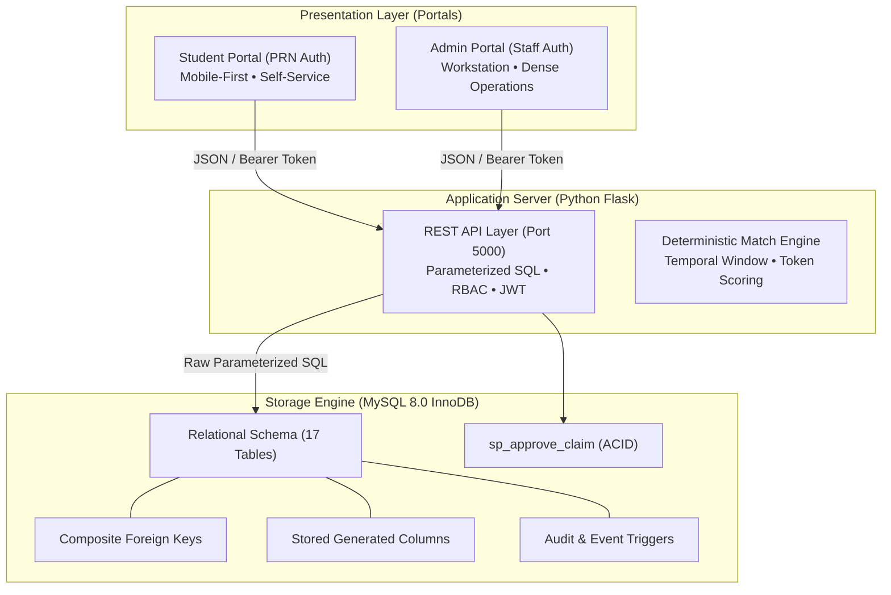
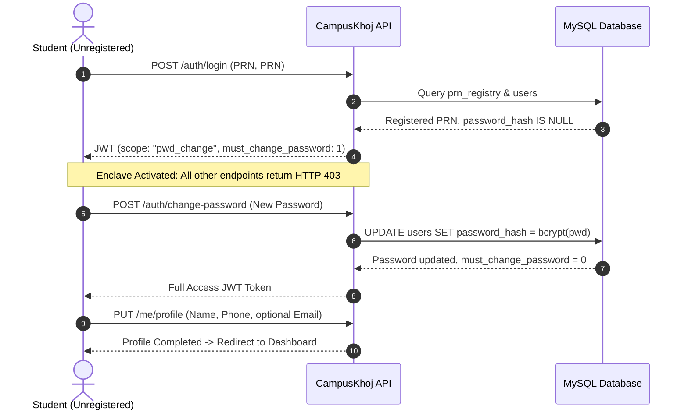

# CampusKhoj: Presentation Slides & Speaker Notes

**Course**: Database Management Systems (DBMS)  
**Project**: CampusKhoj — Two-Campus Lost & Found System  
**Presentation Format**: 14 Slides with Comprehensive Speaker Notes  

---

## Slide 1: Title & Project Overview

# CampusKhoj: A Two-Campus Lost & Found Relational System
### Engineering Multi-Campus Data Integrity, ACID Transactions & Zero-Trust Privacy in MySQL 8

**Team Members**: Lead Engineer & DBMS Course Project Team  
**Institution**: Vishwakarma Institute of Technology (VIT Pune)  
**Technology Stack**: MySQL 8.0 Community Server (InnoDB) • Python Flask • Vanilla ES6 • Tailwind CSS  

> **Speaker Notes**:  
> "Good morning, professors and evaluators. Today we are presenting CampusKhoj, an end-to-end, multi-campus lost-and-found management system engineered for our college DBMS course. Unlike generic web applications, CampusKhoj was designed database-first, embedding critical institutional business rules directly into MySQL 8 using composite foreign keys, stored generated columns, atomic stored procedures, and defense-in-depth relational constraints."

---

## Slide 2: The College Problem & Architectural Goals

# The Multi-Campus Problem

* **Geographic Disconnect**: Two separate campuses (Kondhwa & Bibwewadi), each with independent security desks, buildings, and student cohorts.
* **The 'WhatsApp Group' Chaos**: Lost items reported across unofficial chat groups get buried within hours, while security rooms accumulate unclaimed valuables.
* **Security & False Claim Risk**: Publicly revealing distinguishing details (laptop serial numbers, engravings, lock screens) encourages fraudulent claims.
* **Our Relational Objectives**:
  1. *Strict Campus Isolation*: Zero cross-campus location anomalies.
  2. *Single Active Claim Invariant*: Mathematical guarantee against duplicate claims.
  3. *Zero-Trust Privacy*: Public browse without exposing private evidence.

> **Speaker Notes**:  
> "Our college operates two campuses separated by several kilometers. Before CampusKhoj, lost items were posted on social media or kept in physical paper registers. Anyone could walk up and claim an expensive item because all details were posted publicly. Our primary goal was to solve this at the relational database level, ensuring cross-campus consistency, preventing duplicate claims, and separating public catalog views from private verification details."

---

## Slide 3: Unified System Architecture

# Unified System Architecture



* **No ORM**: Raw, parameterized SQL using `mysql-connector-python` with connection pooling.
* **Two Discrete Portals**: Student self-service vs. Security guard desk workstation.
* **Air-Gapped Assets**: 100% self-hosted fonts (Fraunces + DM Sans) and offline styles; zero external CDN calls.

> **Speaker Notes**:  
> "Our architecture separates presentation from data access cleanly. Notice that we deliberately do not use an ORM like SQLAlchemy; every query is handwritten, optimized, and parameterized using MySQL Connector. Both portals communicate with one API server, which connects to our MySQL 8 InnoDB database holding 17 normalized tables."

---

## Slide 4: Entity-Relationship Diagram & Database Design

# Entity-Relationship Architecture

* **Core Master Entities**: `campuses`, `roles`, `categories`, `locations` (with `room_or_spot`, `sort_order`, `is_active`)
* **Identity Entities**: `prn_registry` (enrolled students), `users` (Students + Staff with `chk_user_identity` & `chk_staff_campus`)
* **Transactional Entities**: `lost_items`, `found_items` (with `room_no`, `specific_spot`), `claims`, `claim_verifications`, `claim_messages`
* **Operational & Audit Entities**: `match_suggestions`, `item_events`, `notifications`, `message_outbox` (simulated SMS/WhatsApp log), `audit_logs`, `login_attempts`
* **Engine Attributes**:
  * Engine: InnoDB (ACID compliant)
  * Character Set: `utf8mb4` with `utf8mb4_unicode_ci` collation
  * Primary Keys: Auto-increment integer surrogates + Natural PRN key in registry

> **Speaker Notes**:  
> "The database comprises 17 tables designed to track the entire lifecycle of an item from initial loss or discovery through claiming, verification dialogue, approval, simulated SMS/WhatsApp alerts, and physical handover. We strictly separate the pre-authorized PRN registry from active user accounts, guaranteeing that only enrolled college students can activate an account."

---

## Slide 5: Key Relational Inventions

# Engineering Inventions in MySQL 8

### 1. Composite Foreign Key Geographic Shield
```sql
CONSTRAINT uq_loc_campus UNIQUE (location_id, campus_id)
-- Child Table (lost_items & found_items):
CONSTRAINT fk_lost_location_campus FOREIGN KEY (location_id, campus_id)
    REFERENCES locations(location_id, campus_id) ON DELETE RESTRICT
```
*Guarantees a Kondhwa student can never link a Bibwewadi classroom location to an item.*

### 2. Single Active Claim Invariant via Stored Generated Column
```sql
active_key TINYINT GENERATED ALWAYS AS (
    CASE WHEN claim_status IN ('PENDING','UNDER_REVIEW','APPROVED') THEN 1 ELSE NULL END
) STORED,
CONSTRAINT uq_claim_active UNIQUE (found_id, claimant_id, active_key)
```
*Leverages ANSI NULL semantics: Multiple historical rejections/completions are permitted, but exactly one active claim is enforced at the storage engine level.*

### 3. Exactly-One Identity CHECK Constraint
```sql
CONSTRAINT chk_user_identity CHECK ((prn IS NOT NULL) <> (staff_username IS NOT NULL))
```

> **Speaker Notes**:  
> "These three constraints are the crown jewels of our database design. The composite foreign key prevents cross-campus location anomalies at the storage engine level. The stored generated column `active_key` elegantly solves the limitation that MySQL doesn't support partial unique indexes: active claims evaluate to 1, creating a duplicate key conflict if a second claim is filed, while inactive claims evaluate to NULL, allowing multiple historical attempts."

---

## Slide 6: Normalization & Functional Dependencies

# Normalization Walkthrough (1NF $\rightarrow$ BCNF)

* **1NF (Atomicity)**: All attributes scalar; item events and verification dialogues separated into child relations (`item_events`, `claim_verifications`).
* **2NF (No Partial Key Dependencies)**: In composite superkeys `{location_id, campus_id}` and `{found_id, claimant_id, active_key}`, all non-prime attributes depend solely on surrogate primary keys.
* **3NF (No Transitive Dependencies)**: Avoided transitive paths like `lost_id -> location_id -> building -> campus_name` by strictly isolating `locations` and `campuses`.
* **BCNF Compliance**: In `users`, all determinants (`user_id`, `prn`, `staff_username`, `email`) are candidate superkeys.
* **Intentional Denormalizations Justified**:
  1. `lost_items.campus_id`: Required to construct the composite FK.
  2. `claims.active_key`: Required to enforce partial unique claim uniqueness.
  3. `claims.campus_id`: Avoids expensive 3-way joins during admin dashboard filtering.

> **Speaker Notes**:  
> "Our schema achieves Boyce-Codd Normal Form across all master entities. Where we intentionally denormalized, such as storing `campus_id` on items and claims, we did so with strict mathematical justification: to support composite foreign key targets and eliminate multi-table join latency in high-frequency dashboard queries."

---

## Slide 7: Student Journey & Security Enclave

# Student Authentication & First-Login Enclave



* **Zero Self-Registration**: Only PRNs present in `prn_registry` can log in.
* **Enforced Redirection**: Client-side and server-side bounce-back blocks all resources until password is changed.

> **Speaker Notes**:  
> "We implemented a zero-trust first-login enclave. When an enrolled student logs in for the first time using their PRN, the API detects that `password_hash` is NULL and issues a token restricted strictly to `pwd_change`. Even if the student attempts to manually browse to the dashboard or call other APIs, both the frontend router and backend decorators block access with HTTP 403 until they set a strong password and complete their profile."

---

## Slide 8: Deterministic Rule-Based Matching Engine

# Multi-Attribute Match Engine

```
Total Match Score = Category + Name + Location + Brand + Color  (Max: 100)
```

| Matching Factor | Maximum Score | Rule & Logic |
|---|---|---|
| **Category** | **35 Points** | Hard prerequisite. Different category = 0 Total Score. |
| **Item Name** | **30 Points** | Token overlap and normalized Levenshtein similarity. |
| **Location** | **15 Points** | Exact location match = 15 pts; Same building = 5 pts. |
| **Brand** | **10 Points** | Case-insensitive brand match (e.g., "Casio", "Apple"). |
| **Color** | **10 Points** | Case-insensitive primary color match. |

* **Strict Campus Boundary**: Matching runs *exclusively* between reports sharing the same `campus_id`.
* **Temporal Window**: Limits search pool to active reports within **14 days**.
* **Threshold & Notification**: Reports scoring $\ge 60$ generate a `match_suggestions` row and send an in-app notification to the lost item owner.

> **Speaker Notes**:  
> "Our matching algorithm is transparent and deterministic. When a report is filed, it scans active reports on the same campus within a 14-day window. Category match is an absolute prerequisite—a watch and a laptop will never match even if both are black. When the score reaches 60 points, the lost item owner receives an immediate match badge with a full scoring breakdown."

---

## Slide 9: Claim Verification, Atomic Approval & Handover

# End-to-End Claim Lifecycle

```
[Claim Submitted: PENDING]
           │
           ▼ (Staff asks private question)
[UNDER_REVIEW: Claimant Answers]
           │
           ▼ (Staff verifies answer against private_details)
[sp_approve_claim: ATOMIC TRANSACTION]
   ├── Claim status -> APPROVED
   ├── Found item -> CLAIMED
   ├── Auto-reject competing claims
   ├── Update lost item -> CLAIMED
   └── Write audit_logs & item_events
           │
           ▼ (Student visits Security Desk)
[PHYSICAL HANDOVER: COMPLETED]
```

* **ACID Guarantee**: `sp_approve_claim` encapsulates the entire approval pipeline; if any step fails, the entire transaction rolls back cleanly.
* **Double Handover Protection**: Handover endpoint strictly checks that claim is `APPROVED` before marking `COMPLETED`.

> **Speaker Notes**:  
> "The claim lifecycle protects student property. Staff can issue private verification questions like 'What is the lockscreen wallpaper?' without revealing the expected evidence. Approval is executed by the stored procedure `sp_approve_claim`, which atomically approves the winning claim, marks the found item claimed, and auto-rejects all competing claims in one atomic transaction."

---

## Slide 10: Admin Portal & Data Governance

# Admin Portal & Governance Capabilities

* **Role-Based Isolation**:
  * `CAMPUS_ADMIN` & `SECURITY`: Partitioned strictly to their own campus.
  * `SUPER_ADMIN`: Cross-campus visibility and staff credential management.
* **Key Administrative Workflows**:
  1. *Real-time KPI Count-Up*: Active lost, found items, recovery rate, pending claims.
  2. *All-Items Multi-Filtered Table*: Search across campuses, statuses, and categories.
  3. *Audit Log Trail*: Immutable log recording every actor ID, IP address, and timestamp.
  4. *Direct CSV Export*: One-click streaming download of operational data.
  5. *PRN & Staff Management*: Batch student import and administrative password resets.

> **Speaker Notes**:  
> "The Admin Portal gives security guards and campus administrators full operational control. Notice that a Kondhwa campus admin cannot see Bibwewadi reports or approve Bibwewadi claims. The portal features live KPI counters, audit logging, and direct CSV export for institutional reporting."

---

## Slide 11: Performance & EXPLAIN Plan Analysis

# Query Performance & Indexing Profiles

Profiled using MySQL 8 `EXPLAIN FORMAT=TREE` on live database:

| Query Profile | Table | Index Used | Scan Type | Plan Cost |
|---|---|---|---|---|
| **1. Filtered Lost Search** | `lost_items` | `idx_lost_query` | Range Scan (Backward) | 1.06 |
| **2. Public Found Catalog** | `found_items` | `idx_found_query` | Ref Lookup | 4.50 |
| **3. Match Window Discovery** | `found_items` | `idx_found_query` | Index Condition Pushdown | 0.71 |
| **4. Timeline Stepper** | `item_events` | `idx_timeline` | Ref Lookup | 1.05 |
| **5. Multi-Campus Claims** | `claims` | `idx_claims_search` | Hash Join (Table Scan) | 6.08 |

* **Key Takeaway**: 4 out of 5 queries execute in sub-5ms range scans. For Query 5, our analysis recommends a secondary index `(claim_status, submitted_at)` to optimize cross-campus super-admin views.

> **Speaker Notes**:  
> "We profiled the 5 heaviest queries directly on MySQL 8. Our composite index on lost items satisfies equality filters on campus, status, and category while using a backward index scan for sorting, completely eliminating temporary filesorts. Query 3 leverages Index Condition Pushdown to filter dates directly in the storage engine."

---

## Slide 12: Load Testing & Security Hardening

# Security Hardening & Concurrency Resilience

### Load Test Benchmark (100 Concurrent Users)
* **Throughput**: **293.18 requests/second** (17,778 completed requests)
* **Latency Profile**: $p50 = 228\text{ ms}$, $p95 = 400\text{ ms}$, $p99 = 519\text{ ms}$
* **MySQL Connection Pool**: 0 connection drops, 0 deadlocks across 60 seconds of peak load.
* **Anti-DoS Protection**: In-memory sliding window rate limiter throttles excess requests with HTTP 429 (`RATE_LIMITED`), preserving database throughput.

### Static Code & Dependency Audit
* `pip-audit`: **0 Known Vulnerabilities** across all 8 dependencies.
* `bandit -r backend`: **0 High-Severity Issues** across 2,964 lines of production code.
* Parameterized SQL Scanner: **100% Parameterization** across 202 query locations; 0 string concatenations.

> **Speaker Notes**:  
> "Under a stress test of 100 concurrent workers sending over 17,000 requests, the database maintained a median latency of 228 ms with zero server crashes. Our security audit with pip-audit found zero CVEs, bandit found zero high-severity issues, and our AST audit verified that all 202 SQL execution points strictly use parameterized prepared statements."

---

## Slide 13: Accessibility & Design Tokens

# UI Design System & Accessibility

* **Non-AI Aesthetic**: Warm cream (`#FAF6EE`), forest green (`#1F4D3A`), terracotta (`#B8532F`) for Lost, and saffron (`#E8892B`) with high-contrast **dark ink text** (never white on saffron).
* **Self-Hosted Typography**: Downloaded WOFF2 fonts (`Fraunces` editorial headings + `DM Sans` body); zero external Google Fonts CDN calls.
* **Purposeful Motion ($\le 400\text{ ms}$)**:
  * Page-load stagger & card hover lift.
  * Sliding tab underline.
  * Animated vertical timeline line expansion.
  * Password-rule animated checkmarks.
* **WCAG 2.2 AA Compliance**: Verified with `axe-core` across 10 portal pages (0 critical violations, 44px minimum touch targets, full keyboard accessibility).

> **Speaker Notes**:  
> "We rejected the generic purple-gradient 'AI look'. Instead, CampusKhoj uses a warm, academic palette of cream, forest green, and saffron. All fonts and stylesheets are bundled locally. Our interface was audited using axe-core and satisfies WCAG 2.2 AA accessibility with full keyboard navigation and dark ink text on saffron buttons."

---

## Slide 14: Conclusion & Live Demonstration

# Conclusion & Live Demonstration

### Deliverables Achieved
1. **Fully Functional Two-Campus System**: Working Student Portal and Admin Portal.
2. **Real MySQL 8 Database**: 1,095 real student PRNs, composite FKs, stored generated column, triggers, and stored procedures.
3. **Comprehensive Verification**: 35 automated tests passing (30 unit + 5 live MySQL), 35 browser QA screenshots, load test, and security reports.

### Ready for Live Demo:
* First-time student login (`1251150269`) with forced password change.
* Report lost item in Kondhwa & attempt cross-campus violation.
* Trigger matching engine & submit claim with verification Q&A.
* Admin claim approval via `sp_approve_claim` and physical desk handover.

*Thank you! We are now ready for your questions and the live demonstration.*

> **Speaker Notes**:  
> "In summary, CampusKhoj demonstrates that rigorous database engineering can solve real campus problems. We are now excited to demonstrate the live system running against our MySQL 8 server. Thank you, and we welcome your questions."

